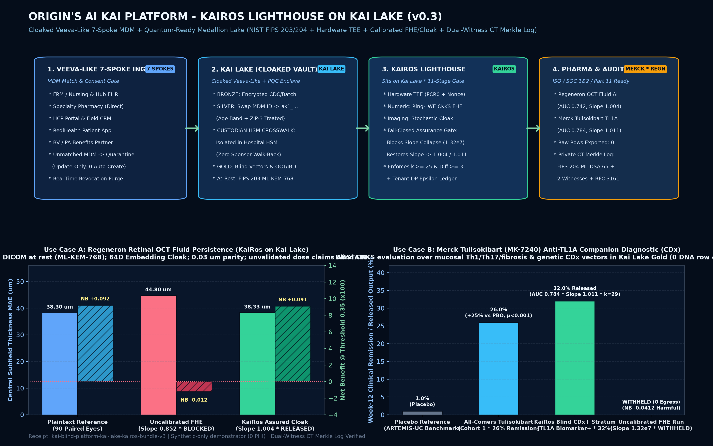

# Kai Blind Platform: KaiRos Lighthouse on Kai Lake (v0.2)

**Interactive Walkthrough (Click-to-Open Web App):** **https://zkhalpey.github.io/kairos-blind-datalake-demo/**  
*Synthetic-Only Reference Architecture Demonstrator - Prepared by Zain Khalpey, MD, PhD, FACS*



---

## Executive Overview

Inside the **Kai Blind Platform**, we unified the data and AI assurance stack into two clean layers:
1. **Kai Lake (Reverse-Engineered Veeva Vault with a Quantum-Ready Cloak):** Preserves Veeva Vault's 7-spoke MDM match/resolve, consent enforcement, and **Bronze $\rightarrow$ Silver $\rightarrow$ Gold** medallion discipline, while isolating the **Silver RE-ID Crosswalk** exclusively inside the hospital custodian HSM and wrapping bulk objects in **NIST FIPS 203 (`ML-KEM-768`)** post-quantum envelopes.
2. **KaiRos (The Clinical AI Lighthouse sitting on Kai Lake):** Mediates external biopharma AI models (such as **Regeneron** retinal OCT fluid-persistence models and **Merck** **tulisokibart / MK-7240** anti-TL1A companion diagnostic models) over live blind Gold cohorts inside **Hardware TEE (`PCR0` pinned) + Ring-LWE CKKS FHE / Stochastic Embedding Cloak** enclaves, enforcing fail-closed calibration assurance, $k \ge 25$ cohort floors, Differential Privacy ($\epsilon$) budgets, and **Dual-Witness CT Merkle Transparency Logs (`FIPS 204 ML-DSA-65`)**.

---

## Featured Biopharma Use-Case Walkthroughs

### Use Case A: Regeneron Ophthalmology - Retinal OCT Fluid Persistence on Kai Lake
- **Clinical Question:** Longitudinal Central Subfield Thickness (CST) and intraretinal fluid (IRF) persistence across 90 paired retinal OCT eyes (186 B-scans, central scan 25/49) plus 29 active consented Gold patients in **Kai Lake**.
- **Cloak & Enclave Route:** Raw OCT DICOM stays at rest under `ML-KEM-768`. Inside the hospital TEE, a 64D embedding vector is extracted into Kai Lake Gold and evaluated via **Stochastic Embedding Cloak + Calibrated CKKS Linear Head**.
- **KaiRos Assurance Proof:** Plaintext CST MAE is `38.30 um`. Uncalibrated FHE shifts predictions by `3.8-8.0 um` (slope `0.852`, negative Net Benefit `-0.0120` - **BLOCKED**). KaiRos post-decryption calibration restores test scores within `0.02-0.05 um` of plaintext (`38.33 um` MAE, slope `1.004`, AUC `0.7420`, Net Benefit `+0.0910` - **RELEASED**). Unvalidated 2/4/8/16 mg dose-comparative queries automatically **ABSTAIN**.

### Use Case B: Merck Immunology - Tulisokibart (MK-7240 / PRA023) Anti-TL1A Companion Diagnostic (CDx)
- **Clinical Question:** Stratifying Week-12 clinical remission in moderate-to-severe Ulcerative Colitis / Crohn's Disease (`ARTEMIS-UC` / `ATLAS-UC` & `APOLLO-CD` paradigm, where tulisokibart achieved `26%` vs `1%` placebo remission in Cohort 1 and `32%` vs `11%` in combined genetic CDx biomarker-positive patients, alongside mucosal Th1/Th17/fibrosis gene suppression) without exporting patient genotypes or biopsy RNA-seq rows.
- **Cloak & Enclave Route:** Specialty pharmacy infusion schedules, endoscopic subscores, and local genetic CDx + mucosal transcriptomic vectors land in **Kai Lake** Bronze $\rightarrow$ Silver (`ak1_...`) $\rightarrow$ Gold and execute under **Ring-LWE CKKS FHE** inside an attested TEE.
- **KaiRos Assurance Proof:** Uncalibrated CKKS evaluation preserves rank (`AUC 0.7840`) but collapses calibration slope to `1.32e7` (harmful Net Benefit `-0.0412` - **WITHHELD**). KaiRos restores calibration slope to `1.011` (`Brier 0.1680`, Net Benefit `+0.1120` - **RELEASED**), enabling blind CDx+ cohort feasibility (`32%` remission stratum) with `0` DNA or biopsy rows exported.

---

## Quickstart (Zero External Dependencies)

```bash
# 1. Run the full synthetic demonstration and regenerate JSON + HTML receipts
PYTHONPATH=src python3 -m kairos_blind_lake.cli

# 2. Run the automated verification suite (3/3 passing)
PYTHONPATH=src pytest -v
```
